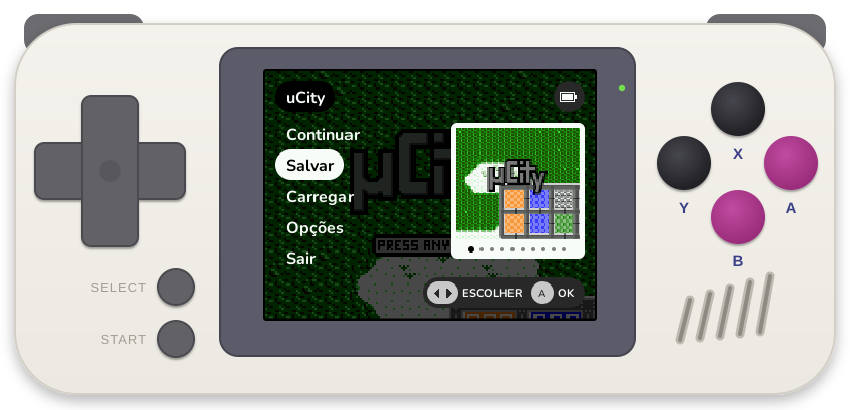
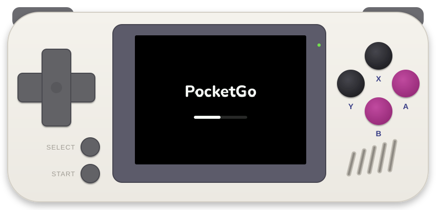
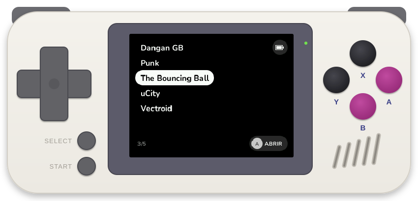
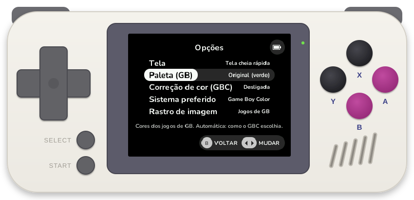

# MeuPocketGB

**Transforme o seu PocketGo num Game Boy Color de bolso.**

<p align="center">
  
</p>

O PocketGo (Bittboy, primeira versão) costuma vir com um sistema que roda dezenas de
emuladores, cheio de menus, ícones e configurações. O MeuPocketGB faz o caminho
contrário: tira tudo isso e deixa o console fazendo **uma coisa só, e bem feita**:
jogar Game Boy e Game Boy Color.

Você liga, e o jogo continua de onde parou. Como era com o cartucho.

## Por que usar

- 🎮 **Liga direto no jogo.** Ao ligar, o último jogo abre no ponto exato em que você
  parou. Quer outro? Segure SELECT ao ligar e escolha na lista.
- 💾 **Nunca perde o progresso.** A chave do PocketGo corta a energia na hora, e no
  sistema original quem desligava sem sair do emulador perdia o save. Aqui o save é
  gravado sozinho, segundos depois que o jogo salva, e o ponto onde você estava é
  guardado a cada minuto.
- ⚡ **Liga rápido.** Cerca de 6,5 segundos do botão ON até o jogo, sem logos nem
  animações no caminho.
- 🧹 **Simples de verdade.** Uma lista só com os seus jogos de GB e GBC, com nomes
  limpos (sem ".gbc" nem "(USA, Europe)"). Sem GMenu2X, sem outros emuladores.
- 🇧🇷 **Menus em português**, minimalistas, em tela cheia: fundo preto, letras brancas,
  inspirados no visual do MinUI.
- 🎨 **Cores de Game Boy.** O verdinho original, as 12 paletas que o Game Boy Color
  oferecia para jogos antigos (ou a escolha automática, como o GBC fazia), correção de
  cor da tela do GBC e o "rastro" de imagem da tela original.

## Como fica na tela

Capturas reais do sistema (com jogos homebrew livres que já vêm no cartão):

<table>
  <tr>
    <td align="center" width="50%">
      <br>
      <strong>Ligando</strong><br>
      <sub>Sem logos nem perguntas: o nome do console e uma barra de progresso.</sub>
    </td>
    <td align="center" width="50%">
      <br>
      <strong>Lista de jogos</strong><br>
      <sub>Só os seus jogos, com nomes limpos. Também dá para separar por pasta.</sub>
    </td>
  </tr>
  <tr>
    <td align="center" width="50%">
      <br>
      <strong>Menu do jogo</strong><br>
      <sub>Continuar, salvar e carregar em 10 espaços, com miniatura de cada um.</sub>
    </td>
    <td align="center" width="50%">
      <br>
      <strong>Opções</strong><br>
      <sub>Cada ajuste muda com esquerda/direita e vale na hora.</sub>
    </td>
  </tr>
</table>

## Como começar

Você vai precisar de um PocketGo v1, um cartão microSD e um computador.

1. Baixe o arquivo `meupocketgb-...img.gz` na página de
   [**Releases**](https://github.com/idelmiro/MeuPocketGB/releases).
2. Grave no cartão com o [Balena Etcher](https://etcher.balena.io/) ou o
   [Rufus](https://rufus.ie/) (eles aceitam o `.gz` direto, não precisa descompactar).
3. Coloque o cartão no console e ligue. Na primeira vez ele se configura sozinho, sem
   fazer perguntas (leva alguns segundos a mais).
4. Desligue, coloque o cartão no computador e copie os seus jogos `.gb` e `.gbc` para a
   partição **ROMS**.

Pronto. É só jogar.

> 💡 **Já usa o MiyooCFW 2.0?** Existe também o *modo rápido*, que instala o MeuPocketGB
> no cartão que você já tem, sem regravar nada. Veja o passo a passo em
> [cartao/LEIA-ME.md](cartao/LEIA-ME.md).

> ⚠️ Antes de apagar o seu cartão atual, faça uma cópia dele (por exemplo, com o
> *Win32 Disk Imager*) ou use outro microSD. Use a versão **v1.2 ou mais nova**: as
> imagens v1.0 e v1.1 tinham um problema no primeiro boot.

## Usando no dia a dia

| Botão | O que faz |
|---|---|
| Ligar | Continua o último jogo de onde parou |
| SELECT segurado ao ligar | Abre a lista de jogos |
| Botão de atalho (menu) | Continuar, Salvar, Carregar, Opções, Sair |
| L e R | Não fazem nada (como no Game Boy, que não tinha esses botões) |

No menu do jogo você tem 10 espaços para salvar o estado (escolha com esquerda/direita,
com miniatura da tela salva). Em **Opções** ficam a paleta de cores, a correção de cor do
GBC, o rastro de imagem, reiniciar o jogo e códigos de Game Genie / GameShark.

**Logo do Game Boy ao abrir o jogo:** funciona se você copiar as BIOS do seu console
para `MAIN/.gambatte/bios/` (`gb_bios.bin` e `gbc_bios.bin`). Elas não vêm no sistema
por direitos autorais.

## Se algo der errado

- **Um jogo não abre:** o motivo aparece no topo da lista (ex.: *ROM INVALIDA*) e fica
  anotado no arquivo `meupocketgb-erros.txt`, na partição ROMS.
- ***ROM VAZIA: RECOPIE*:** o arquivo chegou com 0 bytes. Copie de novo e sempre
  **ejete** o cartão no computador antes de tirá-lo (no Linux, a gravação só termina
  alguns segundos depois da cópia).
- **O Linux pede administrador para gravar na partição ROMS:** rode uma vez
  `sudo chmod -R a+rwX /run/media/$USER/ROMS`.
- **Quero voltar a ligar na lista:** apague o arquivo `.gambatte/ultimo-jogo.txt` na
  partição MAIN, ou segure SELECT ao ligar.

## Comparado ao MiyooCFW

| | MiyooCFW | MeuPocketGB |
|---|---|---|
| Ao ligar | Menu GMenu2X | Continua o último jogo |
| Emuladores | Dezenas | Só Game Boy / Game Boy Color |
| Tela de boot | Logo do Miyoo + animação | Nome do console + barra de progresso |
| Tempo até jogar | ~7 s | ~6,5 s |
| Save do jogo | Só ao sair do emulador | Automático, ~2 s depois que o jogo salva |
| Menus | Em inglês, 160x144 | Em português, 320x240 |

## Créditos e licença

O MeuPocketGB existe graças a dois projetos open source:
[MiyooCFW](https://github.com/MiyooCFW/buildroot), que dá a base do sistema, e
[Gambatte-DMS](https://github.com/tiopex/gambatte-dms), o emulador. O visual dos menus
é inspirado no [MinUI](https://github.com/shauninman/MinUI) (com código próprio) e a
fonte é a Nunito (SIL OFL 1.1).

Assim como eles, este projeto é distribuído sob a licença **GPL-2.0**.

O MeuPocketGB foi desenvolvido em parceria com o **Claude** (modelo **Opus 5.5**, da
Anthropic), usado pelo Claude Code. A ideia, as decisões e todos os testes no console de
verdade foram do autor; o Claude escreveu e ajustou o código, os patches do emulador, do
kernel e do u-boot, mediu o tempo de boot e investigou os problemas encontrados pelo caminho.

---

<details>
<summary><strong>🔧 Para quem quer mexer no código</strong></summary>

### O que muda por dentro em relação ao MiyooCFW

| | MiyooCFW | MeuPocketGB |
|---|---|---|
| Tela inicial | GMenu2X | Lista de jogos `.gb` e `.gbc` juntos |
| Emuladores | Dezenas (RetroArch + IPKs) | Só o Gambatte |
| Teste de RAID6 do kernel a cada boot | Sim (~1,2 s) | Não |
| Esperas para ligar a tela (u-boot + kernel) | ~1,8 s | ~0,6 s |
| Partição MAIN (saves, configurações) | btrfs | ext4 (sem carregar btrfs no boot) |
| Partição ROMS | ext4 com blocos de 1 KB | ext4 com blocos de 4 KB (monta 5x mais rápido) |
| USB (MTP) no boot | Sim | Desligado (dá para religar no `options.cfg`) |
| Brilho no boot | Cai para 50% e volta depois | Constante (o nível salvo é aplicado logo no início) |
| Ombros L e R no jogo | L = avanço rápido (sem som), R = menu | Sem função (o menu fica no botão de atalho) |

O save é gravado de forma segura: um arquivo temporário é gravado e só depois substitui
o anterior. O estado para continuar o jogo fica em
`.gambatte/saves/<jogo>_continuar.gqs` (partição MAIN), gravado a cada minuto, sempre
que o jogo grava o próprio save e quando o menu é aberto. É um arquivo à parte: os slots
de save state 0 a 9 do menu não são tocados.

O primeiro boot da imagem completa usa um instalador próprio
(`firmware/board/meupocketgb/boot/firstboot`) no lugar do instalador do MiyooCFW: ele
configura o PocketGo e aumenta a partição ROMS até o fim do cartão, sem reiniciar. O que
ele fez fica em `MAIN/log_firstboot.txt`.

### Como os arquivos são gerados

Tudo é compilado pelo GitHub Actions ([.github/workflows/build.yml](.github/workflows/build.yml)):

1. **teste** (minutos): aplica os patches, compila o emulador no PC e roda o teste do save automático.
2. **emulador** (horas na 1ª vez, depois usa cache): compila o SDK estático do MiyooCFW e o Gambatte para o modo rápido.
3. **firmware** (algumas horas): compila a imagem completa com o Buildroot.

Para publicar uma versão, crie uma tag (ex.: `v1.0`): os dois arquivos vão para uma *Release*.

Também dá para compilar num PC com Debian/Ubuntu:

```sh
scripts/build-firmware.sh          # imagem completa
FAZER_SDK=1 scripts/build-emulador.sh   # SDK + binário do modo rápido
```

Num contêiner Ubuntu 22.04 (ex.: `distrobox` no Fedora/Bazzite), instale além das
dependências do workflow: `subversion patch autoconf automake libtool pkg-config gettext texinfo`
(o runner do GitHub já vem com elas).

Depois de mudar um patch em `emulador/patches/`, recompile só o emulador e refaça a imagem
(`-rebuild` **não** reaplica os patches; use `-dirclean`):

```sh
# dentro do contêiner (distrobox enter ...), a partir da raiz do repositório
cd build/buildroot
make BR2_EXTERNAL=$PWD/../../firmware gambatte-meupocketgb-dirclean
make MINIMAL=yes all    # a imagem nova sai como output/images/miyoo-*.img
```

Depois de mudar o kernel (`linux.fragment` ou um patch em `firmware/board/meupocketgb/kernel/`):

```sh
make BR2_EXTERNAL=$PWD/../../firmware linux-dirclean linux-fusion-dirclean
make MINIMAL=yes all
```

Depois de mudar um patch do u-boot (`firmware/board/meupocketgb/uboot/`):

```sh
make BR2_EXTERNAL=$PWD/../../firmware uboot-dirclean
make MINIMAL=yes all
```

O kernel e o u-boot do MiyooCFW vêm de `origin/master`, sem commit fixo. Se um dos nossos
patches deixar de aplicar, o build para e avisa: ajuste o patch ao código novo.
O u-boot tem só 1 KB de memória no começo (`SYS_MALLOC_F_LEN=0x400`): ligar
`CONFIG_BOOTSTAGE` faz ele travar antes de acender a tela.

O `linux-fusion` guarda uma cópia dos módulos do kernel e, sem o `dirclean`, a imagem
sai com os módulos antigos. Sempre use `MINIMAL=yes`: sem ele a imagem fica com 3 GB e
o `main.img` grande continua lá (apague `output/images/main.img` para voltar ao normal).

As versões do MiyooCFW/buildroot e do Gambatte-DMS ficam fixadas por commit nos
scripts. Para atualizar, troque o commit e confira se o *teste* e o *firmware* passam.

### Testar os menus no PC

Compile com `EXTRA_DEFINES=-DMPGB_TEST`: `MPGB_TECLAS="ESPERA:120,MENU,BAIXO,A"` aperta
botões e `MPGB_CAPTURAS=/pasta` salva cada tela como BMP. A fonte embutida sai de
`emulador/ui/gerar-fonte.py` e a tela de boot de
`firmware/board/meupocketgb/boot/gerar-tela-boot.py` (precisam do Pillow).

A paleta automática para jogos de GB usa a tabela do gambatte-libretro (GPL), que escolhe
pelo título como o GBC fazia.

### Estrutura do repositório

```
emulador/patches/   mudanças no Gambatte-DMS (lista única de ROMs, save automático,
                    marcas de tempo, continuar o jogo, L/R sem função, menus, lista por pasta)
emulador/ui/        fonte Nunito (OFL) e o gerador da fonte embutida nos menus
cartao/             arquivos do modo rápido (vão para a partição BOOT)
firmware/           árvore externa do Buildroot (BR2_EXTERNAL)
  configs/meupocketgb.fragment     o que entra e o que sai da imagem
  package/gambatte-meupocketgb/    pacote do emulador
  board/meupocketgb/rootfs/etc/main  script de boot enxuto
  board/meupocketgb/preparar-buildroot.sh  ajustes no MiyooCFW antes de compilar
scripts/            build-firmware.sh e build-emulador.sh
docs/               imagens deste README: telas/ (capturas reais) e as ilustrações do
                    console, geradas por docs/gerar-ilustracoes.py
```

### Medir o tempo de boot

Crie um arquivo vazio `medir-boot.txt` na partição ROMS: 20 s depois de ligar ele recebe
o log do kernel com as marcas `meupocketgb:` de cada etapa (apague o arquivo para parar).
Onde ainda vai o tempo (PocketGo, nov/2026, total ~6,5 s): ~3,1 s antes do kernel (ROM do
chip, SPL, u-boot, leitura do kernel no cartão), ~1 s do kernel, ~0,5 s montando as
partições, 0,5 s ligando a tela, 0,23 s do som (módulo), 0,28 s até o Gambatte rodar,
0,27 s no vídeo do SDL e 0,19 s no som do SDL (ALSA).

O PocketGo v1 não tem armazenamento interno: o F1C100s só tem 32 MB de RAM e liga direto
do cartão SD (o sistema original da Miyoo também roda do cartão).

### Ideias para depois

- Boot ainda mais rápido.
- Tirar do Gambatte os menus de configuração que não forem usados.

</details>
